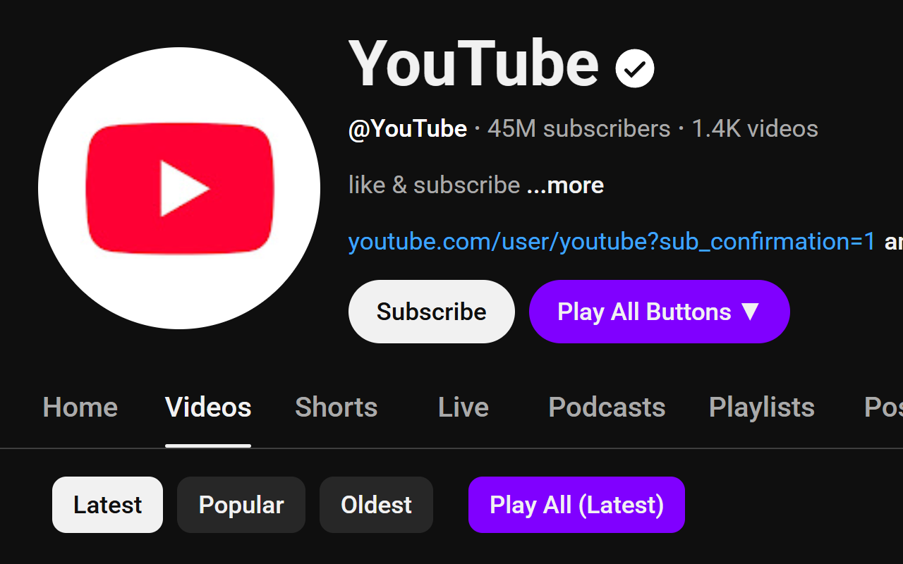
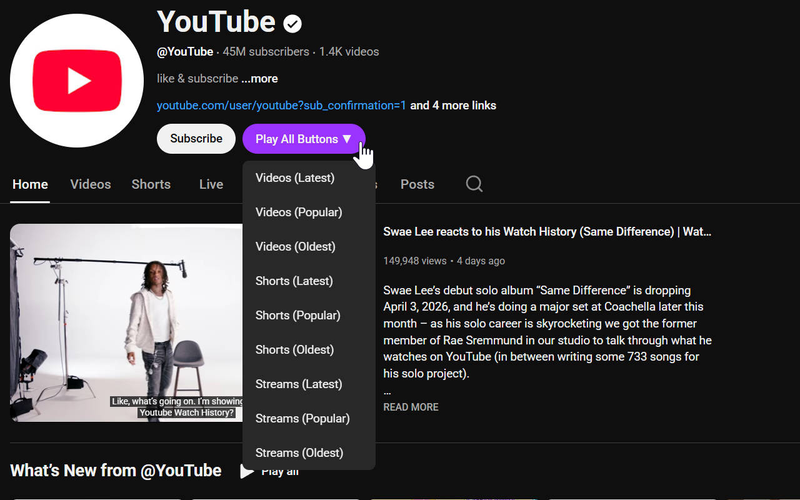

# Youtube Play All

Youtube Play All is a browser extension that adds "Play All" buttons for Videos, Shorts, and Streams on YouTube, with sorting by Latest, Popular, or Oldest.

## Features

- Adds "Play All" buttons to YouTube channel pages.
- Supports category options (Videos, Shorts and Streams)
- Supports sort options (Latest, Popular and Oldest)
- Supports mobile pages.

## Playlist support

The following combinations are supported on desktop and mobile YouTube channel pages. “Public” refers to the regular channel playlists, rather than the members-only playlists.

| Audience     | Category | Latest        | Popular       | Oldest                              |
| ------------ | -------- | ------------- | ------------- | ----------------------------------- |
| Public       | Videos   | Supported     | Supported     | Supported — mixed categories [1]    |
| Public       | Shorts   | Supported     | Supported     | Supported — mixed categories [1][2] |
| Public       | Streams  | Supported     | Supported     | Supported — mixed categories [1]    |
| Members only | Videos   | Supported [3] | Not supported | Starts at oldest item [3][4]        |
| Members only | Shorts   | Not supported | Not supported | Not supported                       |
| Members only | Streams  | Supported [3] | Not supported | Starts at oldest item [3][4]        |

1. Public Oldest mixes all three categories in oldest-first order. It starts at your category's oldest video. This may not be the playlist's first video.
2. Shorts / Oldest starts at the oldest public Short. The channel page may show a members-only Short first.
3. Members-only options appear only on channels with memberships, if the playlist loads. YouTube's access rules still apply.
4. Members-only Oldest starts at the last video. It does not reverse the playlist.

## Screenshots

---

## Usage

1. Download the extension from the [Chrome Web Store] or [Firefox Add-ons].
2. Open any YouTube channel and go to the Videos tab. (e.g., [@YouTube]).
3. Choose a sorting option (Latest, Popular, Oldest).
4. Click the "Play All" button to play videos in the chosen order.

[Chrome Web Store]: https://chromewebstore.google.com/detail/youtube-play-all/lcgfhpllcjejniehjnhbfhnkdpmkeoce
[Firefox Add-ons]: https://addons.mozilla.org/firefox/addon/youtube-play-all/
[@YouTube]: https://www.youtube.com/@YouTube/videos

## Issues

Report any issues or bugs here:
https://github.com/CatBraaain/browser-youtube-play-all/issues
